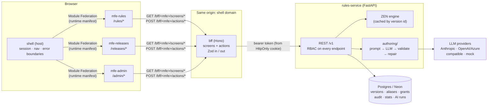
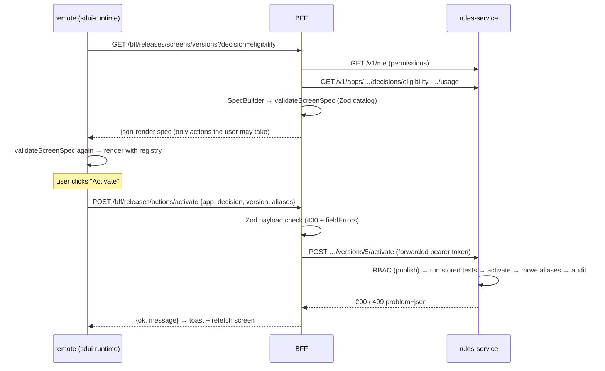
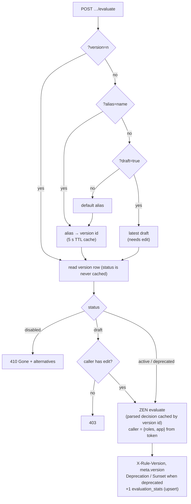
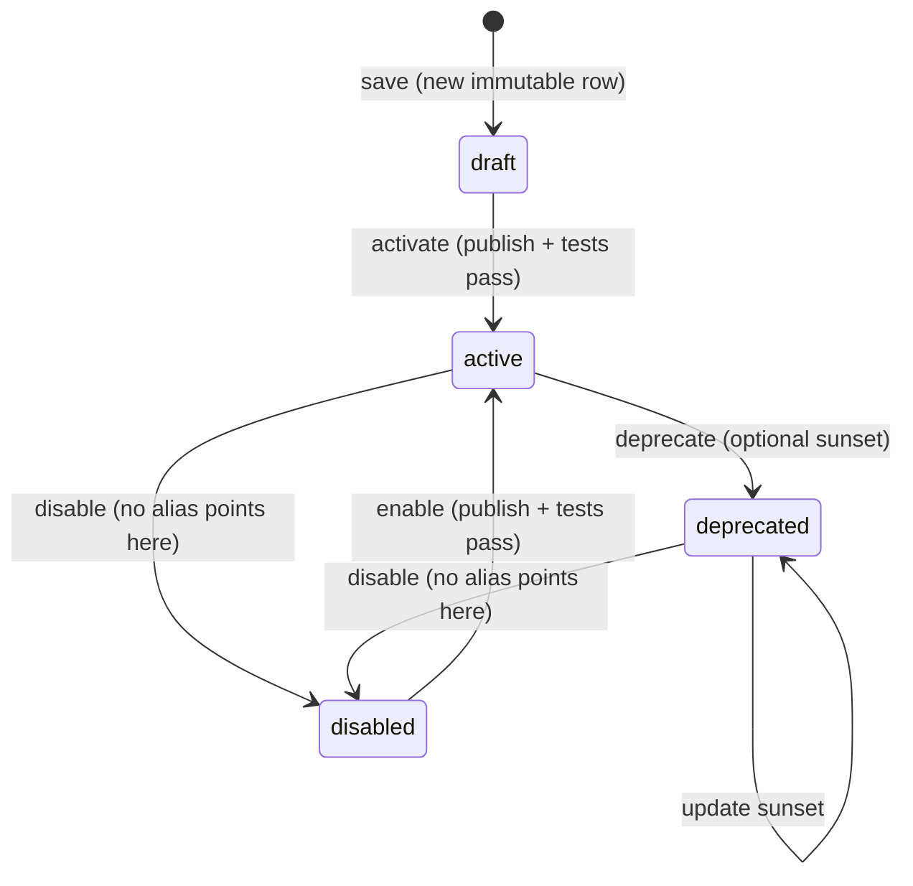
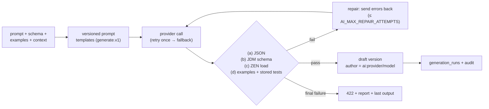

# Architecture

## Components



| Piece | Responsibility | Never does |
|---|---|---|
| **shell** | Session, login (demo) or OIDC hand-off, permission-filtered nav, loads remotes from `/mfe-manifest.json`, isolates failures | Talk to rules-service, hold tokens in JS |
| **remotes** | Map their sub-routes to BFF screens; render specs with `@rules/sdui-runtime` | Hardcode screens or permissions |
| **bff** | Build json-render specs from service data **and** the caller's permissions; validate every spec (Zod catalog) and every action payload (`@rules/schemas`) | Store rule state, enforce security, call LLMs |
| **rules-service** | Source of truth: versions, lifecycle, aliases, RBAC, audit, evaluation, AI generation | Trust the BFF's view of permissions |

## Server-driven UI



- **Catalog** (`packages/ui-registry/src/catalog.ts`): Zod prop schemas for every
  component. It is server-safe; the BFF imports it to validate before responding.
- **Registry** (`packages/ui-registry/src/react.tsx`): the React implementation of each
  catalog component. Domain components (`JdmEditor`, `VersionDiff`, `TestPanel`,
  `AiGeneratePanel`, `ProviderSettings`, `AuditTimeline`) live in `src/domain/` and load
  heavy data through BFF actions. The graph JSON is never embedded in a spec.
- **Runtime** (`packages/sdui-runtime`): `useScreen` → validate → `JSONUIProvider` +
  `Renderer`, with action handlers for `navigate`, `submit`, `refresh`, `openModal`,
  `closeModal` and `toast`.

## Evaluation and version resolution



## Version lifecycle



Any number of versions can be active at once. Aliases (`default`, `stable`, `beta`, …)
point only at active or deprecated versions. Rollback means moving `default` back.
Content is immutable: a database trigger rejects updates to `content` and `checksum`.

## AI rule generation



Guardrails: per-user and per-app hourly limits and monthly token budgets (counted in
Postgres), input caps, `context_text` delimited as data, and API keys resolved only inside
rules-service through `SecretResolver` and redacted everywhere. Generated drafts go through
the same activation gate as hand-written ones.

## Auth and RBAC

- **Local/demo:** the rules-service dev issuer mints HS256 JWTs for the seeded users. The
  BFF stores the token in an HttpOnly cookie. It runs only when `ENV=local`, or with
  `DEMO_AUTH=true` outside production, and the service refuses to start with demo auth on
  the production deployment.
- **Production:** OIDC (issuer, audience, JWKS URL; roles and groups claims) by
  configuration.
- **Permissions:** `view`, `edit`, `publish`, `evaluate` and `admin`, granted to users or
  groups per application (or globally). `admin` implies everything; `edit` and `publish`
  imply `view`. The UI only *shapes* screens with them; rules-service checks every request.

## Ports (local)

| Port | Service |
|---|---|
| 5173 | shell |
| 5174 / 5175 / 5176 | mfe-rules / mfe-releases / mfe-admin |
| 8787 | bff |
| 8000 | rules-service (`/docs`, `/openapi.json`) |
| 5432 | postgres |

## Repository layout

```
apps/web/{shell,mfe-rules,mfe-releases,mfe-admin}   Vite + React 19 + Module Federation
apps/api/bff                                        Hono BFF
apps/api/rules-service                              FastAPI + SQLAlchemy + Alembic + zen-engine
  app/authoring/                                    LLM providers, prompts, pipeline, guardrails
packages/schemas      shared Zod DTOs and action payloads
packages/ui-registry  json-render catalog (Zod) + React registry (+ domain components)
packages/sdui-runtime fetch → validate → render → dispatch; shell/remote contract
packages/auth         permission helpers, <Can/>, useSession
packages/api-client   generated rules-service client (openapi-typescript + openapi-fetch)
packages/config       tsconfig / eslint / vitest presets
e2e/                  Playwright (demo path, MFE isolation)
infra/                docker-compose, Vercel setup
```
